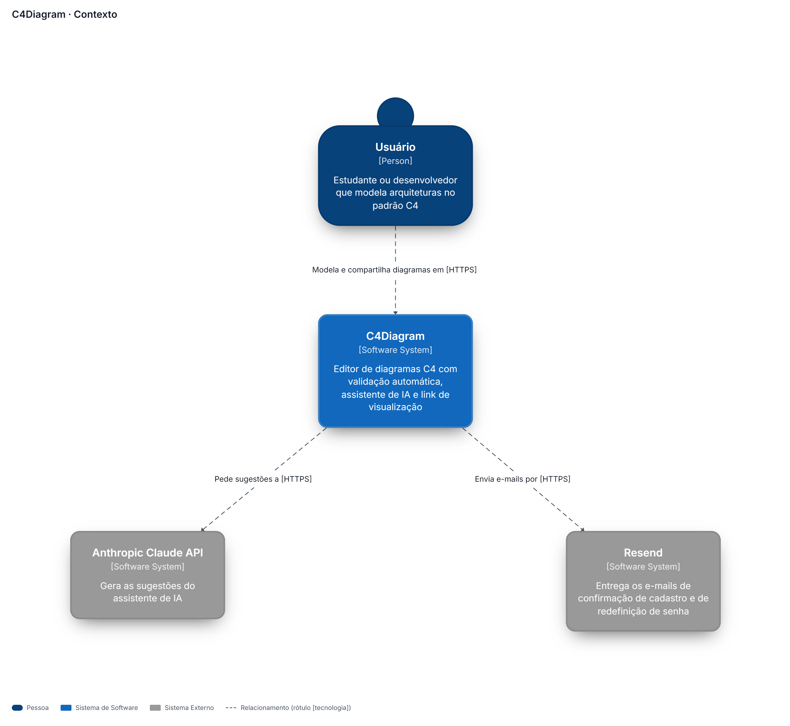
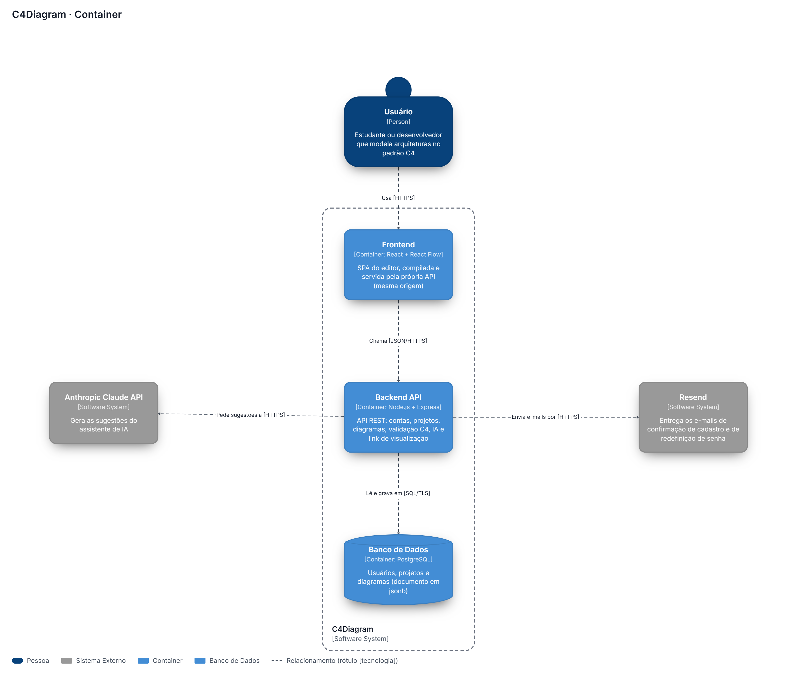
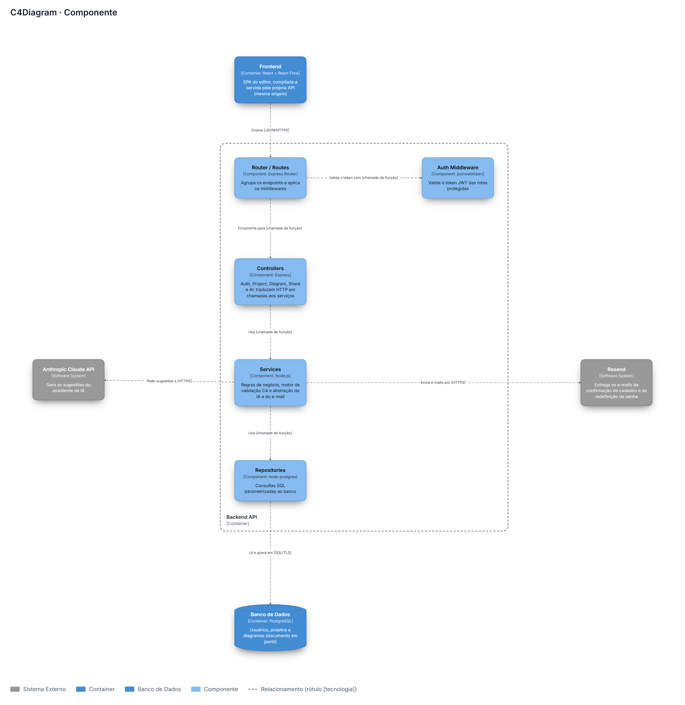

# 5 Arquitetura do Sistema

Esta seção descreve como o sistema será construído, apresentando as decisões arquiteturais tomadas e sua justificativa. O objetivo é fornecer uma visão clara e progressiva da estrutura do sistema — desde sua posição no ambiente externo até a organização interna dos seus componentes — além do modelo de dados adotado e das tecnologias que compõem a stack.
A arquitetura foi definida considerando o contexto do projeto: equipe solo, prazo de seis meses e foco na entrega de um MVP funcional. As escolhas priorizam familiaridade tecnológica, simplicidade operacional e adequação ao escopo definido nos capítulos anteriores, sem abrir mão de boas práticas de organização e separação de responsabilidades.

---

## 5.1 Diagrama C4

Esta seção apresenta a arquitetura do sistema nos três primeiros níveis do modelo C4, descrevendo progressivamente como o sistema se encaixa no ambiente externo, como está estruturado internamente e como seus componentes se organizam.

Os diagramas foram modelados **no próprio C4Diagram** e exportados pela exportação de imagem (RF18): a ferramenta documenta a si mesma. Os três níveis passam pelo motor de validação (RF17) sem nenhum aviso. O modelo está em [c4diagram-modelo.json](../assets/c4diagram-modelo.json) e pode ser aberto no editor pela opção **Importar projeto** (RF21).

---

### 5.1.1 Nível 1 — Diagrama de Contexto

Visão macro do sistema. Apresenta o C4Diagram como uma caixa preta e suas interações com os atores e sistemas externos, sem detalhar tecnologias ou implementação.

**O que está representado:**
- **Usuário** — estudante ou desenvolvedor que modela arquiteturas no padrão C4
- **C4Diagram** — o sistema sendo documentado: editor com validação automática, assistente de IA e link de visualização
- **Anthropic Claude API** — sistema externo de IA responsável pelas sugestões (RF16)
- **Resend** — sistema externo que entrega os e-mails de confirmação de cadastro e de redefinição de senha

*Figura 7 — Diagrama de Contexto*

---

### 5.1.2 Nível 2 — Diagrama de Containers

Primeiro nível de zoom. Decompõe o C4Diagram em suas unidades de execução independentes, apresentando as decisões tecnológicas fundamentais e como os containers se comunicam.

**Containers representados:**
- **Frontend** — SPA em React + React Flow, compilada e servida pela própria API (mesma origem, sem CORS entre os dois)
- **Backend API** — API REST em Node.js + Express, numa imagem Docker publicada no Azure App Service
- **Banco de Dados** — PostgreSQL (Azure Database for PostgreSQL — Flexible Server) com dados relacionais e `jsonb` para diagramas

Os sistemas externos ficam fora da fronteira tracejada do C4Diagram e se ligam só à Backend API: as chaves da Anthropic e do Resend nunca chegam ao navegador.

*Figura 8 — Diagrama de Containers*

---

### 5.1.3 Nível 3 — Diagrama de Componentes

Zoom no container **Backend API**, detalhando sua organização interna em camadas e como os componentes se orquestram para processar as requisições.

**Camadas representadas:**
- **Router / Routes** — agrupa endpoints e aplica middlewares
- **Auth Middleware** — validação de token JWT
- **Controllers** — Auth, Project, Diagram, Share (link de visualização) e AI
- **Services** — lógica de negócio, motor de validação C4 e abstração da IA e do e-mail

O Frontend e o Banco de Dados aparecem como containers vizinhos, fora da fronteira da Backend API, como pede a notação. As chamadas internas da API são chamadas de função; só as que saem do processo usam a rede (HTTPS ou SQL sobre TLS).
- **Repositories** — acesso ao banco de dados

*Figura 9 — Diagrama de Componentes*

---

[← Sumário](../sumario.md) | [Próximo: 5.2 Modelo de Dados →](5.2-modelo-de-dados.md)